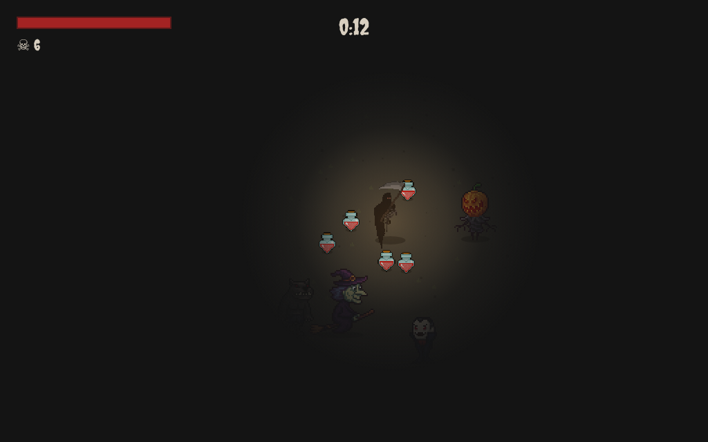
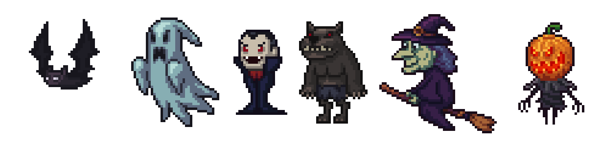
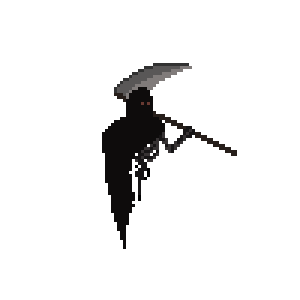
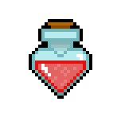
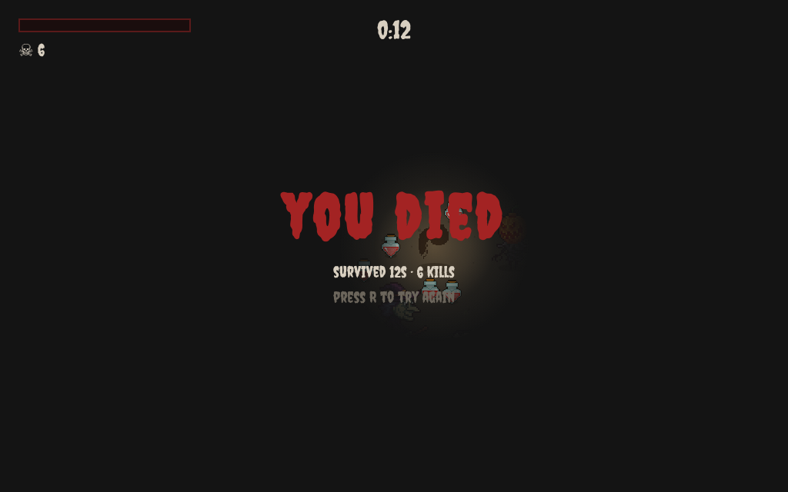

# Halloween Survivors

A small browser survival game with a Halloween cast. You play as the reaper, move through a dark arena, cut down whatever gets close, and pick up potions to keep the run going.



## About the game

The idea is simple. Enemies keep coming from every direction, the screen gets darker outside your small circle of light, and your health bar is the only thing between you and the death screen. The scythe swings on its own when something enters range, so most of the game is about positioning and deciding when to move toward a potion.

There is no menu or upgrade screen. You start in the arena, the timer starts at zero, and the spawn rhythm gets tighter the longer you survive. The HUD shows health, kills, and time. When health reaches zero, the run ends and you can restart with R.

## Controls

| Action | Keys |
| --- | --- |
| Move | W A S D or arrow keys |
| Restart after death | R |

The game is built for a keyboard and a desktop browser. There are no touch controls yet.

## Enemies



| Enemy | Health | Speed | Notes |
| --- | --- | --- | --- |
| Bat | 1 | 1.6 | The fastest enemy, but a single hit is enough |
| Werewolf | 2 | 1.2 | Quick and takes two hits |
| Vampire | 2 | 1.1 | Balanced speed and health |
| Witch | 3 | 1.0 | Slower, but survives three hits |
| Ghost | 2 | 0.9 | Drifts in slowly |
| Jack o lantern | 3 | 0.7 | The slowest and toughest of the group |

Every enemy drops a potion about nine times out of ten. Potions restore 25 health and disappear when you walk over them.

## The reaper

| The reaper | Healing potion |
| --- | --- |
|  |  |

You start with 100 health. The reaper attacks automatically when an enemy gets within 110 pixels, and the swing hits every enemy in that range. The character has idle, attack, and death animations, all taken from sprite sheets in the Assets folder.

## Game over



The final screen shows how long you survived and how many enemies you killed. Press R to reload the page and start a new run.

## How to run locally

You need Python 3 or any other static file server. Clone the repository and start the server from the project folder:

```bash
git clone https://github.com/Nitikpsn/Halloween-survivors.git
cd Halloween-survivors
python3 -m http.server 8000
```

Open [http://localhost:8000](http://localhost:8000) in your browser. Keep the terminal open while you play, then press Ctrl+C to stop the server.

If you use VS Code, the Live Server extension works too. Opening `index.html` directly usually works, but a local server is more reliable for loading images and audio.

## Project layout

| Path | What it contains |
| --- | --- |
| `index.html` | Page structure, HUD, and game over screen |
| `style.css` | Layout, fonts, health bar, and the darkness overlay |
| `script.js` | Player movement, enemy spawning, combat, pickups, and rendering |
| `Assets/` | Reaper sprite sheets, enemy frames, GIF previews, potion art, and the slash sound |
| `screenshots/` | Images used in this README |
| `readme.md` | This file |

## Built with

| Part | Technology |
| --- | --- |
| Rendering | HTML5 Canvas 2D |
| Game logic | Vanilla JavaScript |
| Layout and effects | CSS, including the radial light overlay |
| Audio | HTMLAudioElement |
| Art | Aseprite sprite sheets and PNG animation frames |
| Fonts | Creepster and Pixelify Sans from Google Fonts |

There are no packages to install and no build step. A modern browser is enough.

## How it works

The game runs on a single canvas with a `requestAnimationFrame` loop. Player and enemy positions are plain numbers, and distance checks use `Math.hypot`. The darkness comes from a CSS radial gradient that follows the player, which sits above the canvas and below the HUD.

The reaper art is loaded from sprite sheets with 100 by 100 frames. Enemy art is loaded as four separate PNG frames per character and cycled in the draw loop. Slash sounds are cloned before playback so quick attacks do not cut each other off.

The game is split into three files with no build step: the page, the styles, and one script. That makes it easy to open, read, and change without a toolchain.

## Adding another enemy

Add an entry to the `enemyTypes` array in `script.js`, then place four frames in `Assets/Halloween Characters/<Folder>/Png_animation/`. The loader expects files named `<Name>1.png` through `<Name>4.png`, matching the `name` and `folder` values in the array.

## Notes

This is a prototype. There is one weapon, one arena, and no pause or upgrade system. The fun comes from the small scale: a short run, a growing crowd, and one more potion just out of reach.

