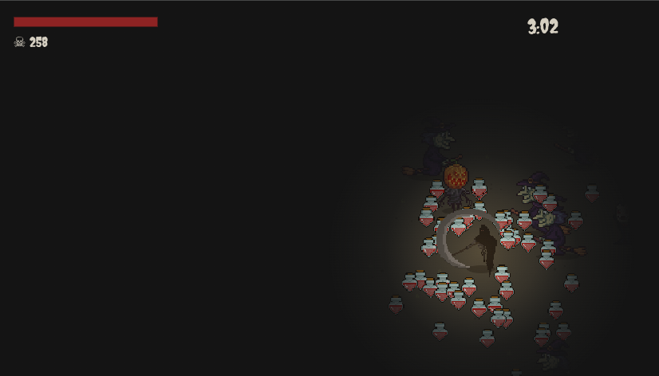

# Halloween Survivors

<p align="center">
  
</p>

<p align="center">
  A vamipre survivors like bullet heaven game built on the theme of All Hallows' Eve.
</p>


## Story

The development of this game first started at boba bash delhi, an event organized by hackclub. It was an awesome event and met amazing people, this project is also part of the 3am YSWS over at hackclub where we have to ship a dark themed project. 

## Gameplay

You play as death, the spirits of All hallows' eve have gone rouge, your object is to slice them with your sythe and send them back to the realm of the dead, over time the spirits would enlarge in numbers and also drop potions, creating a fun and adicting bullet heaven experience. 


## 🎮 Controls
The game has the same controls as any other game
| Key | Action |
| :--- | :--- |
| W / ↑ | Move Up |
| A / ← | Move Left |
| S / ↓ | Move Down |
| D / → | Move Right |
| R | Restart immediately upon death |

*Attacks are automatic as soon as you get close to an enemy*


## Features
The game as of now supports multiple sprites across with different enemies, I've also recently added potions that drop after a enemy is slain, which heals your health and helps you keep going. For the future of the game the plan is to add more weapons so the game becomes more engaging and always have a suprise/fun factor. Also need to make different types of enemies(for eg: long range attackers.) Will be implemented soon™ 🤞


## Contribute

Please feel free to contibute to the game it would be really appreciated, the game runs on the HTML canvas with `script.js` having most of the logic. below are the steps to run it locally. 


### Run locally
1. Clone the repository:
   ```bash
   git clone https://github.com/AaravAtGit/Halloween-survivors.git
   cd Halloween-survivors
   ```

    You can double click on the index.html file to launch the game, Although a live server would be preferable, you can run one by using `python -m http.server` or `npx serve .` alternatively you can use the live server extention in vsc marketplace.   

### Asset credits
The assets I've used were picked from itch.io. Below are the links to the itch.io page of the assets I used. 

- Player sprite - [undead-executioner by DarkPixel](https://darkpixel-kronovi.itch.io/undead-executioner)
- Enemy sprites - [2D animated halloween characters by ismartyl](https://ismartal.itch.io/2d-animated-halloween-characters)
- Health potion - [Hearth shaped potion by lorenet](https://lornent.itch.io/heart-shaped-potion-bottle)


---

<p align="center">
  Made with 🧡 by <a href="https://github.com/AaravAtGit">AaravAtGit</a>
</p>