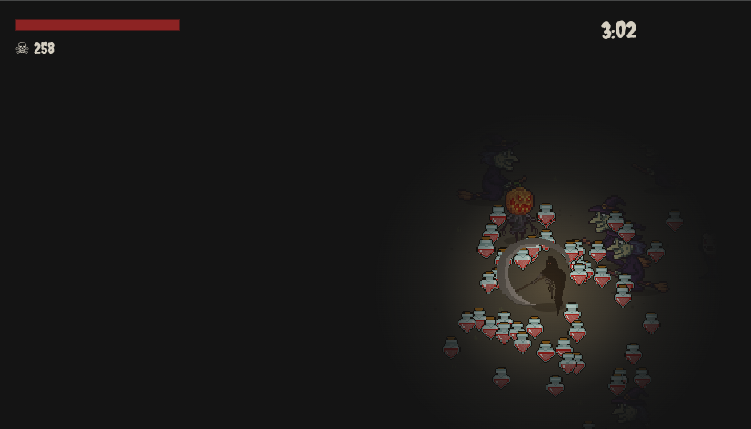
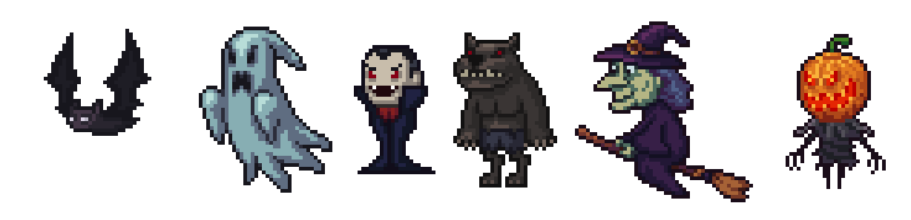

# Halloween Survivors

<p align="center">
  
</p>

<p align="center">
  A Vampire Survivors-like bullet heaven game built around All Hallows' Eve.
</p>

## Story

You play as Death. The spirits of All Hallows' Eve have gone rogue, and your job is to slice them with your scythe and send them back to the realm of the dead. They come at you from every direction, there are more of them the longer you last, and everything outside a small circle of light around you stays dark.

The scythe swings on its own whenever something gets within 110 pixels, and it hits everything in that range at once. So most of the game is about positioning and deciding when it's worth running for a potion. Enemies drop a potion about 9 times out of 10, and each one heals 25 HP. You start with 100.

There's no menu or upgrade screen yet. You spawn straight into the arena, the timer starts, and the HUD shows your health, kills and time. When your health hits zero you get a screen with how long you survived and how many enemies you killed. Press R to go again.

## Controls

The game has the same controls as most other games.

| Key | Action |
| :--- | :--- |
| W / ↑ | Move up |
| A / ← | Move left |
| S / ↓ | Move down |
| D / → | Move right |
| R | Restart after death |

*Attacks are automatic as soon as you get close to an enemy.* It's keyboard only for now, so no touch controls yet.

## Enemies



| Enemy | Health | Speed | Notes |
| --- | --- | --- | --- |
| Bat | 1 | 1.6 | Fastest one, but dies in a single hit |
| Werewolf | 2 | 1.2 | Quick and takes two hits |
| Vampire | 2 | 1.1 | Middle of the pack |
| Witch | 3 | 1.0 | Slower, but takes three hits |
| Ghost | 2 | 0.9 | Drifts in slowly |
| Jack o' lantern | 3 | 0.7 | Slowest and toughest |

## Features

Right now the game has six enemies with their own sprites, the reaper has idle, attack and death animations, and enemies drop potions when they die so you can keep going. Next I want to add more weapons so every run has some surprise to it, and different kinds of enemies too (long range attackers, for example). Will be implemented soon™ 🤞

## How it works

There are no packages and no build step. It's just three files: `index.html`, `style.css` and `script.js`, so you can open it and start changing things straight away.

The game runs on a single HTML canvas with a `requestAnimationFrame` loop, and `script.js` has most of the logic (movement, spawning, combat, pickups and drawing). The darkness is a CSS radial gradient that follows the player, sitting above the canvas and below the HUD. The reaper comes from sprite sheets with 100x100 frames, and each enemy is four separate PNG frames that get cycled while drawing. The slash sound gets cloned before it plays so quick attacks don't cut each other off. Fonts are Creepster from Google Fonts.

## Contribute

Please feel free to contribute to the game, it would be really appreciated. The steps to run it locally are below.

### Run locally

1. Clone the repository:
   ```bash
   git clone https://github.com/AaravAtGit/Halloween-survivors.git
   cd Halloween-survivors
   ```

2. Start a local server from the project folder:
   ```bash
   python3 -m http.server 8000
   ```
   Then open [http://localhost:8000](http://localhost:8000). `npx serve .` works too, or you can use the Live Server extension from the VS Code marketplace.

You can also just double click `index.html`, but images and audio load more reliably from a server.

### Asset credits

The assets are from itch.io. Here are the pages for the ones I used:

- Player sprite - [Undead Executioner by DarkPixel](https://darkpixel-kronovi.itch.io/undead-executioner)
- Enemy sprites - [2D Animated Halloween Characters by ismartal](https://ismartal.itch.io/2d-animated-halloween-characters)
- Health potion - [Heart Shaped Potion Bottle by lornent](https://lornent.itch.io/heart-shaped-potion-bottle)
- Creepster font - [Creepster on Google Fonts](https://fonts.google.com/specimen/Creepster)


---

<p align="center">
  Made with 🧡 by <a href="https://github.com/AaravAtGit">AaravAtGit</a>
</p>

